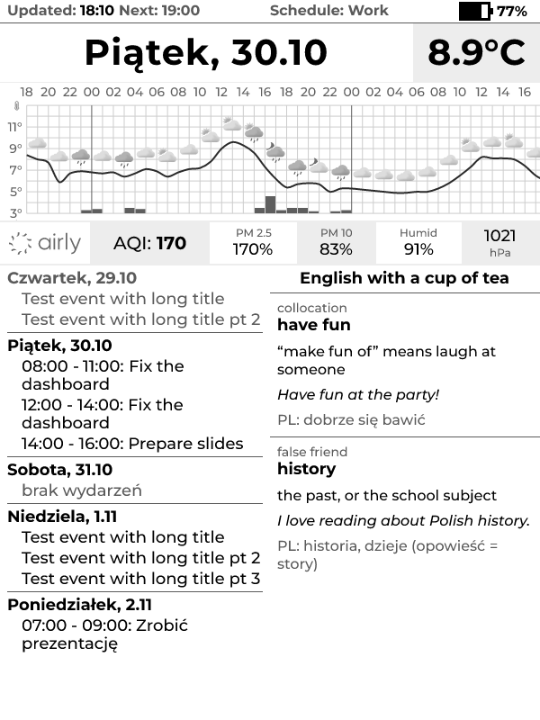
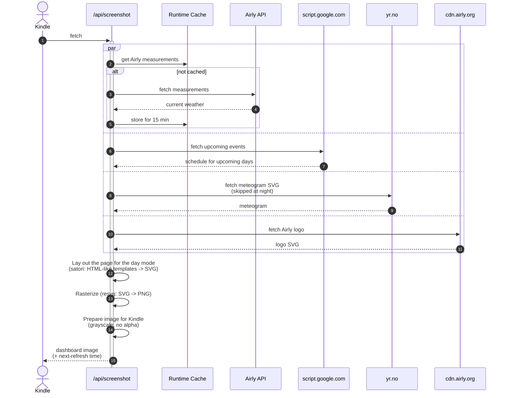

# Kindle Page

This is my home dashboard to be shown on the Kindle as a Frame.

There is a Vercel API function that generates the PNG ready to be shown
on the Kindle device.

See related projects:

- Kindle code: https://github.com/bukowskiadam/kindle-onlinescreensaver
- Kindle fetch-file binary: https://github.com/bukowskiadam/fetch-file

## Example

## Running

1. Install `npm install`
2. Run dev mode `npm start` (needs the project linked with `vercel link`;
   uses mock calendar and Airly data, no `auth` param needed)
3. Deploy to your app `npm run deploy`
4. Regenerate the sample image `npm run screenshot` (mock calendar and Airly
   data; the meteogram is fetched live)
   (optionally pass a day mode: `npm run screenshot -- night`)

## Application flow

Layouts live in `src/render/components` (one file per page module, `layouts.ts`
maps day modes to layouts). Fonts and images are bundled from `assets/`.
